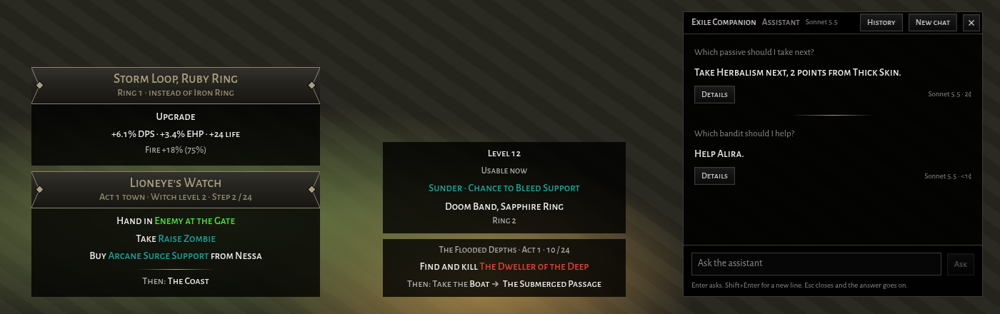

<div align="center">

# Exile Companion

A companion app for Path of Exile 1 that sits over the game. It knows your build and where you are in the campaign, answers questions about the build from your own Path of Building, and walks you through the ten acts.

[](https://github.com/muirch/exile-companion/actions/workflows/ci.yml)
[](LICENSE)




</div>

## What it does

Press Alt+A and ask about your build. The assistant measures every change with your Path of Building, reads the Path of Exile Wiki and knows where you are from the game's log. If you follow a guide, it reads the guide's PoB and the author's notes, and says what your character still lacks and what to change first. Before you ask anything, the chat lists the next gems, passives and gear on the way to your guide's stage, measured without an AI model, so that list is free.

Answers come from Anthropic, OpenRouter or a model server you name, with your own key, at about $0.001 to $0.03 a question depending on the model. Chats are saved on your PC and you can go back to one later. See [docs/chat.md](docs/chat.md).

Most of it needs no AI model or key. The route and its gems, the item check, the level-up and Kitava cards and the chat's list of what to change next are worked out on your PC from the game's log and your Path of Building. Only the chat's answers go to a model.

The campaign overlay looks like one of the game's item tooltips. The header is the area you're in, the body is what to do there and the last line is the way out, in the game's own text colours. It follows the game's `Client.txt` log on its own and shows the speedrunning route from [exile-leveling](https://github.com/HeartofPhos/exile-leveling). With your build imported, it lists each gem at the quest or vendor where you get it, and suggests a mule when another class gets a gem much earlier.

It also checks the item under the cursor against your build (DPS, EHP, life and resistances), says what a level-up made usable, warns before Kitava when your resistances won't stay capped, and shows when an area costs you experience.

The overlay shows only while the game is in front, and clicks go through it.

## Install

Download the setup file from the [dev release](https://github.com/muirch/exile-companion/releases/tag/dev) and run it. A newer build installs over the old one. Builds aren't signed yet, so Windows SmartScreen may ask you to confirm. On Linux, build it from source. The overlay needs X11 or XWayland, which is how the game runs under Proton.

Start it before or after the game. It finds `Client.txt` in the usual Steam and standalone install folders, or you pick the file in the settings. In the settings, paste the guide you follow (a pobb.in or poe.ninja link, a PoB code or a guide page) and import your character from your pathofexile.com profile, which has to be public, or from a PoB file. The route's gems come from the guide, the item check and the assistant's numbers from your character.

## Keys

All of them can be changed in the settings.

| Key | What it does |
|---|---|
| Hold Tilde (left of 1) | Open the quick menu (route and layout, previous and next step, the assistant, settings, moving the overlay, quit) and the gems window with the build's links for your stage |
| Tap Tilde | Show the overlay again after it faded out, and the step's hints in the compact layout |
| Alt+A | Open or close the assistant's chat |
| Alt+M | Unlock the overlay to drag it, press again to lock |
| Alt+Left, Alt+Right | Previous or next step of the route |
| Alt+D | Check the item under the cursor, off until you turn it on |
| F5 | Go to your hideout, off until you turn it on |
| F9 | Relog to character select, off until you turn it on |
| Alt+G | At a vendor, search for the gems the route says to buy there, off until you turn it on |

## How it treats the game

Exile Companion reads `Client.txt`, a log the game writes to disk anyway, the keys you bind and, when you ask, the clipboard. It downloads a build only when you paste its link, and with sync on it reads and writes one build file in PoB's Builds folder. When you ask the assistant, your question and what its tools read about your build and progress go to the AI provider you picked. It doesn't touch the game process, read its memory or hook its rendering, and it doesn't play for you.

Four keys send something to the game, and all are off until you turn them on. F5 types `/hideout` and F9 types `/exit` in chat. Alt+D presses Ctrl+C to copy the item's text. Alt+G types a search into the open vendor window. Each is one action per key press, and only while the game is in front.

Exile Companion isn't affiliated with or endorsed by Grinding Gear Games. Path of Exile is their trademark. It's a free, non-commercial fan tool.

## Next

- A list of models that give good advice with these tools.
- Passive tree guidance while you level.
- Path of Exile 2, after its 1.0 release.

You can also ask through an AI agent you already use, such as Claude Desktop, Claude Code, Cursor or Codex, see [docs/mcp.md](docs/mcp.md).

## For developers

### How it works

The live log and a replayed log both become one stream of lines. One pipeline parses each line, folds it into the campaign state and updates the overlay, so replay behaves like a live session and the engine is tested without a GUI. The assistant runs Path of Building headless and gives the model its tools over MCP, the same server an outside agent uses.

```
app/ui                  the React and TypeScript UI
app/desktop             the Tauri v2 shell with windows, hotkeys, IPC and settings
app/mcp                 the assistant's MCP server
crates/core             campaign logic, no Tauri, covered by tests
crates/assistant        the chat, a model with the MCP server's tools
crates/pob              Path of Building import
crates/pob-engine       Path of Building's calculations run headless, with LuaJIT built in
crates/wiki             the Path of Exile Wiki through its API
crates/guides           build guides with their PoB links from poebuilds.cc
crates/fetch            HTTP with a disk cache for the outside sources
crates/data             the campaign data and route, embedded at build time
tools/data-extractor    builds the campaign data from the game's files
```

The backend is Rust, Tokio and Tauri v2. The UI is React, TypeScript, Vite, Tailwind CSS and Zustand.

### Getting started

You need Rust (stable), Node 22+ and [pnpm](https://pnpm.io/).

```bash
# engine tests, no GUI needed
cargo test -p exile-core

# watch the engine follow a sample campaign log
cargo run -p exile-core --example replay_log

# the UI in a browser with mock data
pnpm install
pnpm dev

# UI tests and lint
pnpm test
pnpm lint

# the PoB engine tests run on a copy of Path of Building, about 220 MB
tools/fetch-pob.sh .pob
EXILE_POB_DIR=$PWD/.pob cargo test -p exile-pob-engine
```

Windows installers come from the manual Release workflow. On Linux, `pnpm tauri build --no-bundle` builds the app to run from `target/release`.

The campaign data pack is committed. For a new league, run the "Update game data" workflow in Actions. It regenerates the data from GGG's patch CDN and the route from exile-leveling, tests them and opens a pull request (see the extractor's [README](tools/data-extractor/README.md)).

### How it's built

I build this with an AI coding agent (Claude Code) on purpose. I set the architecture and the constraints, review every change and test it in the game, and the agent does most of the typing. The rules it works by are in the repo: [AGENTS.md](AGENTS.md) for what the app may do to the game, the checks before a commit and how to write, [PRODUCT.md](PRODUCT.md) for who it's for, and [DESIGN.md](DESIGN.md) with `.impeccable/` for the design system. Every change goes through a pull request and CI.

### Contributing

Issues and pull requests are welcome. Logic lives in `exile-core` and `exile-assistant` and comes with tests, UI behaviour is tested with Vitest next to the component. CI runs rustfmt, Clippy with warnings as errors, the Rust and UI tests, the UI lint and a Windows build. A pull request with the `smoke` label also installs the app on a Windows runner and starts it.

If you open the project in Claude Code, the hooks in `.claude/settings.json` run the impeccable design checks after UI edits and download the impeccable binary the first time. Turn them off with `/impeccable hooks off` if you don't want that.

## Credits and licenses

The leveling route in `crates/data/data/routes/exile-leveling` is written by the exile-leveling authors and kept under its MIT license (see the `LICENSE` file there).

`crates/pob-engine/lua/headless.lua` is adapted from Path of Building Community's headless wrapper, under its MIT license (see `headless.LICENSE` next to it). The engine runs Path of Building itself from a folder on your machine. PoB isn't part of this repo.

The assistant reads the [Path of Exile Wiki](https://www.poewiki.net) through its API, on your machine. Wiki content is under CC BY-NC-SA 3.0 and isn't part of this repo.

The overlay uses Alegreya Sans and Alegreya Sans SC by Huerta Tipográfica, under the SIL Open Font License (`app/ui/src/assets/fonts/OFL.txt`).

The design skill in `.claude/skills/impeccable` is [impeccable](https://github.com/pbakaus/impeccable) by Paul Bakaus, under the Apache License 2.0.

The campaign data pack comes from Path of Exile's game files and is (c) Grinding Gear Games, shared under their fan content policy, so the code license doesn't cover it.

The application code is under the MIT license, see [LICENSE](LICENSE).
