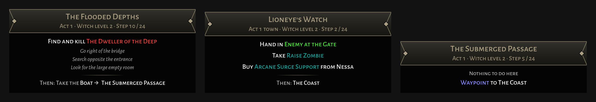

<div align="center">

# Exile Companion

A companion app for Path of Exile that sits over the game. I'm building it for myself first. The goal is an assistant that knows your build and answers questions about it. Today it guides you through the campaign.

[](https://github.com/muirch/exile-companion/actions/workflows/ci.yml)
[](LICENSE)




</div>

## What it does today

The first thing it does is the campaign. Exile Companion sits over the game and looks like one of its item tooltips. The header is the area you're in, the body is what to do there, and the last line is the way out. Bosses, quests, waypoints and trials use the game's own text colours, so you can read a step in one glance between fights.

It follows you on its own. The game writes every area it loads to its `Client.txt` log, and Exile Companion reads that log to know where you are, including the Act 6-10 towns that share names with Act 1-5. Your level tells repeat visits apart. The route is the speedrunning route from [exile-leveling](https://github.com/HeartofPhos/exile-leveling), and you can step through it by hand when you go off it.

Import your Path of Building build, from a file, a PoB code or a pobb.in or poe.ninja link, and the route also says which gem to take from each quest and what to buy from which vendor, at the point the build needs it.

The overlay shows only while the game is in front, and clicks go through it to the game. It starts as a few compact lines between the flask bar and the skill bar. The full layout adds the area header and the route's hints.

## Install

Exile Companion runs on Windows. Download the setup file from the [dev release](https://github.com/muirch/exile-companion/releases/tag/dev) and run it. A newer build installs over the old one. Builds aren't signed yet, so Windows SmartScreen may ask you to confirm.

The app used to be called poebo. If you have poebo installed, uninstall it. Exile Companion picks up its settings and saved build on the first start.

Start Exile Companion before or after the game. It finds `Client.txt` in the usual Steam and standalone install folders. If it doesn't, pick the file in the settings.

## Keys

All of them can be changed in the settings.

| Key | What it does |
|---|---|
| Hold Tilde (left of 1) | Opens the quick menu with route and layout, previous and next step, settings, moving the overlay and quit |
| Tap Tilde | Show the overlay again after it faded out, and the step's hints in the compact layout |
| Alt+M | Unlock the overlay to drag it, press again to lock |
| Alt+Left, Alt+Right | Previous or next step of the route |
| F9 | Relog to character select, off until you turn it on |

## How it treats the game

Exile Companion reads `Client.txt`, a text log the game writes to disk anyway, plus the keys you bind and, when you ask, the clipboard. If you paste a build link (pobb.in, poe.ninja, pastebin and the other sites Path of Building imports from), it downloads that one build. It leaves the game process alone. It doesn't read the game's memory or hook its rendering, and it doesn't play for you.

The relog key is the one thing it sends to the game. When you turn it on, F9 types `/exit` in chat, the way Awakened PoE Trade does. It's one chat command per key press, and only while the game is in front.

Exile Companion isn't affiliated with or endorsed by Grinding Gear Games. Path of Exile is their trademark. It's a free, non-commercial fan tool.

## Where it's going

The campaign guide is the first feature, not the whole app. What I want most is an assistant next to the game that knows my build. I want to ask it why my damage dropped or what to change next, and get an answer from real Path of Building numbers instead of a guess.

- A build assistant you can ask questions, answering from Path of Building's own calculations.
- Passive tree guidance from your build while you level.
- Path of Exile 2, after its 1.0 release.

## For developers

### How it works

The live log and a replayed log both become one stream of lines. A single pipeline reads it, parses each line, folds it into the campaign state and updates the overlay. Replay behaves exactly like a live session, and the whole engine is tested without a GUI.

```
crates/exile-core       campaign logic, no Tauri, covered by tests
crates/exile-data       the campaign data pack, embedded at build time
src-tauri               the Tauri v2 shell with windows, hotkeys, IPC and settings
src                     the React + TypeScript UI
data-pack               generated campaign data and the leveling route
tools/data-extractor    builds the data pack from the game's files
```

The backend is Rust, Tokio and Tauri v2. The UI is React, TypeScript, Vite, Tailwind CSS and Zustand.

### Getting started

You need Rust (stable), Node 22+ and [pnpm](https://pnpm.io/).

```bash
# engine tests, no GUI needed
cargo test -p exile-core

# watch the engine follow a sample campaign log
cargo run -p exile-core --example replay_log

# the UI in a browser with mock data, no Tauri or Windows needed
pnpm install
pnpm dev

# UI tests and lint
pnpm test
pnpm lint
```

The desktop app is built for Windows, by the manual Release workflow or `pnpm tauri build` on Windows. On Linux, work on the UI with `pnpm dev` and on the logic with `cargo test`. There's a sample log at [examples/sample-client.txt](examples/sample-client.txt) for the replay mode.

### Regenerating the campaign data

The data pack is committed, so you only need this when a league changes the campaign. It pulls the tables straight from GGG's patch CDN, no game install required:

```bash
cd tools/data-extractor
npm ci
npm run regen
```

See [tools/data-extractor/README.md](tools/data-extractor/README.md) for details.

### How it's built

This is a side project, and I build it with an AI coding agent (Claude Code) on purpose. I set the architecture and the constraints, review every change and test it in the game. The agent does most of the typing. It's a faster way to get a hobby tool done, and an experiment in how far that workflow goes when you keep it on a short leash.

The leash is in the repo. [AGENTS.md](AGENTS.md) has the project rules. It says what Exile Companion may and may not do to the game, what to run before committing and how to write comments and commits. [PRODUCT.md](PRODUCT.md) says who the tool is for and what it must never do. [DESIGN.md](DESIGN.md) and `.impeccable/` hold the design system, and UI work goes through the impeccable skill. `.claude/settings.json` has the hooks and permission rules every session shares. Every change goes through a pull request and CI before it lands on `main`.

### Contributing

Issues and pull requests are welcome. Logic lives in `exile-core` and comes with tests. UI behaviour is tested with Vitest next to the component. CI runs rustfmt, Clippy with warnings as errors, the Rust and UI tests, the UI lint, a check that the TypeScript bindings are up to date, and a Windows build. A pull request with the `smoke` label also installs the app on a Windows runner and starts it a few times.

If you open the project in Claude Code, the hooks in `.claude/settings.json` run the impeccable design checks after UI edits. They download the impeccable binary the first time. If you don't want that, turn them off with `/impeccable hooks off`. Nothing else depends on Claude Code.

## Credits and licenses

The leveling route in `data-pack/routes/exile-leveling` is written by the exile-leveling authors and kept under its MIT license (see the `LICENSE` file there).

The overlay uses Alegreya Sans and Alegreya Sans SC by Huerta Tipográfica, under the SIL Open Font License (`src/assets/fonts/OFL.txt`).

The design skill in `.claude/skills/impeccable` is [impeccable](https://github.com/pbakaus/impeccable) by Paul Bakaus, under the Apache License 2.0.

The campaign data pack comes from Path of Exile's game files and is (c) Grinding Gear Games, shared under their fan content policy, so the code license doesn't cover it.

The application code is under the MIT license, see [LICENSE](LICENSE).
